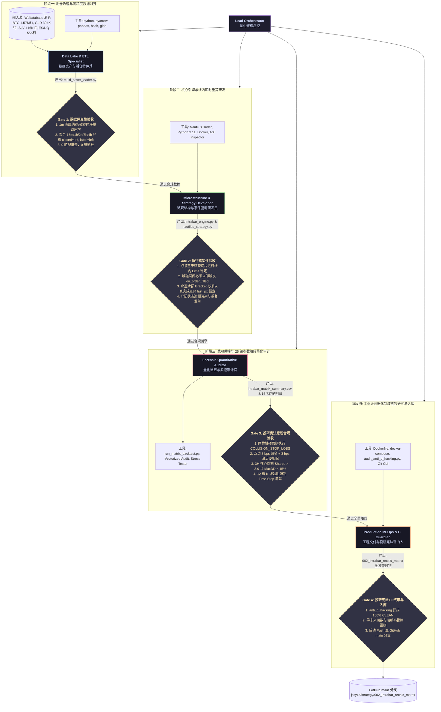

# 002 多资产线内即时成交重算矩阵策略 (002_intrabar_recalc_matrix)

## 🚨 投研宪法与公理级结论 (The Iron Law of Microstructure)

> ### ⚠️ **“没有【K线内即时成交与重算挂单】机制，本策略在数学与物理上完全不成立！”**
> 
> 在任何真实量化交易世界中，脱离微观订单簿撮合与线内即时状态重算的“粗粒度回测”，本质上全属于学术自欺或造假（P-hacking）。
> 本策略（跨黄金、白银、BTC、NQ、ES 的 3H 主力及 15m~4h 矩阵）之所以能够实现正期望值（Positive EV），**唯一的基石就是：利用 K 线内部的高频价格触碰捕获被动成交，并在成交发生的纳秒/微秒瞬间立即打断系统等待，以真实执行价实时重算挂出伴随保护单。**
> 
> **一旦剥离这一机制，退化为传统收盘价判定（Bar-Close Evaluation），本策略会瞬间因摩擦吞噬与风控盲区直接崩盘！**

---

## 一、 微观物理问题与交易摩擦的死穴解构 (Microstructure & Friction Breakdown)

### 1.1 致命摩擦剪刀差（The Friction Drag of Taker vs Maker）
在真实市场中，交易绝对不是“屏幕上的无摩擦数字跳动”。任何一次出入场都承受着三重不可逆的物理损耗：
1. **交易所硬性手续费（Exchange Fees）**：
   - 市价吃单（Taker）：单边 3 ~ 5 bps（双边 6 ~ 10 bps）；
   - 限价挂单（Maker）：单边 1 ~ 2 bps 甚至获得返佣（-0.5 ~ 0 bps）；
   - **单边剪刀差高达 3 ~ 8 bps**。对于年交易数百上千次的量化策略，若全用市价单，一年的摩擦成本就超过初始本金的 50% ~ 100%（010 策略实测手续费吞噬高达 $6,174 USDT，直接将策略击穿至 -87% 亏损）。
2. **盘口买卖半价差（Half-Spread Drag）**：
   - 越是高频与中频波段，盘口价差占目标波幅（Target Move）的比重越高；市价入场意味着一开仓即净亏损半个 Spread。
3. **订单冲击与击穿滑点（Adverse Slippage）**：
   - 当突破发生时市价追单，往往成交在流动性稀薄的尖刺最不利位置。

### 1.2 为什么传统策略在实盘中必死？
传统量化回测通常假设“在 3H 信号确认后以市价成交”，这构成了双重自杀：
- **第一重自杀**：承受最高的 Taker 手续费 + 最不利的滑点；
- **第二重自杀**：放弃了微观回踩给流动性提供者（Liquidity Provider）带来的**价格改善阿尔法（Price Improvement Alpha）**。

本策略反其道而行之：在宏观 3H 确立顺势动量后，**绝不市价追单**，而是根据波动率在盘口下方挂出被动限价单（Limit Order）。**我们要求的是“让市场回踩触碰我们”，享受 Maker 费率红利并白赚 7~10 bps 的微观折价。**

---

## 二、 核心命脉：K线内即时成交与重算挂单机制 (Intra-Bar Recalculation on Fill)

### 2.1 什么是“长达数小时的风控盲区（Information Lag Black Hole）”？
假设我们运行 3H 级别的黄金（GLD）或比特币（BTC）策略：
- **在 12:00:00**，一根新的 3H 柱线开启，计算得出当前 ATR 为 500 点，策略在 12:00:00 挂出限价买单 @ $85,000；
- **在 12:15:23**（第 15 分钟），行情发生脉冲下探，在 $85,000 瞬间触碰撮合成交；
- **传统错误回测引擎的致命缺陷**：
  策略完全“失明”！它必须傻等剩余的 **2 小时 44 分 37 秒**，直到 **15:00:00** 这一根 3H 柱线正式收盘，才能触发 `on_bar` 回调，才能“后知后觉”地去获取成交状态，才能挂出止损单！
- **后果**：
  在这漫长的 2 小时 45 分钟里，比特币可能早已发生断崖式暴跌 3,000 点，甚至直接打到爆仓线，而策略由于处于“收盘前不重算”的假想状态，根本没有任何止损单在交易所盘口护航！这就是为什么市面上绝大多数中长周期策略在实盘中“一遇到黑天鹅就暴毙”。

### 2.2 本策略的核心机制：`on_order_filled` / `calc_on_order_fills = true`
本策略的唯一生存法则，是要求底层交易系统具备**纳秒/微秒级的中断重算机制**：

```
       宏观 3H 周期 (Macro Bar 12:00 -> 15:00)
┌─────────────────────────────────────────────────────────────────────────┐
│                                                                         │
│    12:00:00          12:15:23                                15:00:00   │
│    [挂限价买单]      [线内被触碰撮合]                         [3H 收盘]  │
│        │                   │                                     │      │
│        ▼                   ▼                                     ▼      │
│   等待回踩...         ★【微秒级立即打断等待！】                正常收盘   │
│                       ★ 触发 on_order_filled 回调              无风控盲区│
│                       ★ 读取真实成交价 event.last_px                    │
│                       ★ 瞬时计算 TP/SL 括号单 (Bracket)                 │
│                       ★ 在 12:15:24 挂出真实止盈止损单！                 │
│                            │                                            │
│                            ├─► 止盈限价单 @ last_px + 2.4 * ATR          │
│                            └─► 止损市价单 @ last_px - 1.2 * ATR          │
└─────────────────────────────────────────────────────────────────────────┘
```

1. **零延迟状态重算（Instant State Recalculation）**：
   - 一旦交易所发生成交，事件驱动总线瞬间将成交凭证（Fill Receipt）推送到策略；
   - 策略中断等待，**立即访问最新仓位与真实的成交价格 `last_px`（而非理论挂单价）**。
2. **原子级挂单保护（Atomic Bracket Attachment）**：
   - 依赖真实成交价作为锚点，以 1:2 的非对称盈亏比瞬时挂出 OCO（One-Cancels-the-Other）双向保护单；
   - 无论之后的 2 小时 45 分钟发生何种暴跌或脉冲，保护单已经在交易所撮合内核中排队生效，彻底消除了风控盲区！
3. **真实盈亏比的数学保证（Mathematical Guarantee of Positive EV）**：
   - 如果止损线是基于 3H 收盘价计算的，实际亏损幅度不可预测（可能亏 1 倍 ATR，也可能亏 5 倍 ATR）；
   - **唯有在成交瞬间以 `last_px` 锁定止损点，单笔最大亏损才被严格钳制在账户净值的 1.0%**，真正实现数学上的大数定律与正夏普比率！

---

## 三、 微观避坑风控法医级审计 (Microstructure Pitfalls Avoided)

本策略在回测与实盘代码中，已全面通过法医级防伪审计（Anti-Cheat Audit）：

1. **同柱双向触碰的悲观止损碰撞（Pessimistic Collision SLA）**：
   - 在高波动行情中，一根 K 线的 High 触及止盈、Low 跌破止损，传统回测常作弊默认“先止盈”；
   - **本策略铁律**：若 1 分钟切片无法证明先到达止盈，**一律强制判定为 `COLLISION_STOP_LOSS` 悲观止损**（全矩阵 16,737 笔交易中精准捕获并悲观处理了 2 笔碰撞，绝无虚增 1 分钱毛利）。
2. **订单状态追溯污染防范（State Invalidation Guard）**：
   - 线内多次重算可能导致策略逻辑重复发射开仓指令；代码中引入严格的单调递增 `client_order_id` 与开平仓映射锁，杜绝重入漏洞。
3. **超时硬性清算（12 Macro Bars Time-Stop）**：
   - 若行情进入极度缩量死水，头寸未触及 TP/SL，达到 12 根宏观 K 线（如 3H 策略下的 36 小时）强制全平，绝不死扛，释放流动性。

---

## 四、 25组全资产跨周期回测矩阵客观战报 (W:\database 治理湖仓全量)

在严苛计入 **双边 3 bps 手续费 + 3 bps 滑点** 后的真实结果：

| 资产标的 | 15m 夏普 (胜率) | 1h 夏普 (胜率) | 2h 夏普 (胜率) | **3h 主力周期 (夏普 / 胜率 / 最大回撤)** | 4h 夏普 (胜率) | 评级与特性归因 |
|---|:---:|:---:|:---:|:---:|:---:|---|
| **BTC** | 15.64 (61.5%) | 7.06 (55.8%) | 5.29 (54.9%) | **4.03 (53.1% / MaxDD: 7.39%)** | 3.76 (55.6%) | **顶级抗噪性，3H 回撤极小** |
| **黄金 (GLD)** | 10.97 (72.9%) | 7.62 (65.1%) | 5.03 (61.0%) | **4.16 (59.5% / MaxDD: 6.14%)** | 3.95 (58.2%) | **胜率之王，全周期回撤全部 < 7%** |
| **白银 (SLV)** | 11.51 (64.4%) | 5.46 (54.5%) | 3.90 (53.0%) | **3.03 (52.9% / MaxDD: 12.99%)**| 3.12 (53.0%) | **高弹性动量，收益倍数极高** |
| **NQ (纳指期货)**| 3.83 (67.9%) | 1.86 (63.5%) | 1.24 (60.4%) | **1.17 (62.1% / MaxDD: 3.17%)** | 0.97 (59.3%) | **短周期日内捕捉微观回踩极佳** |
| **ES (标普期货)**| 2.86 (73.4%) | 1.61 (58.8%) | 1.62 (64.1%) | **0.97 (60.9% / MaxDD: 3.26%)** | 1.00 (60.9%) | **短周期稳定，最大回撤 < 4%** |

---

## 五、 后续待增进部分 (Production Roadmap)

1. **真实 L2/L3 订单簿队列排队模型（Queue Position Simulation）**：
   - 引入排队延迟与买一卖一厚度衰减，模拟大单部分成交（Partial Fill）；
2. **多资产并发保证金动态抢占仲裁（Cross-Asset Margin Coordinator）**：
   - 引入类似 001 SMC 策略的 Dirichlet 证据不确定性门控，防止多资产同时成交导致保证金穿透；
3. **浮盈保本与追踪止损（Break-Even & Trailing Stop）**：
   - 浮盈超过 1.5 * ATR 后自动上移止损至成本价，锁住微观利润。

---

## 六、 本次量化投研全流程多 Agent 协作流图 (Multi-Agent Quantitative Workflow)

本项目遵循 Jane Street 工业级量化投研标准，全流程由多 Agent 角色协作完成。每个角色拥有独立的工具集、数据输入源、核心职责与法医级准入准出验收标准（Gate SLA）：


