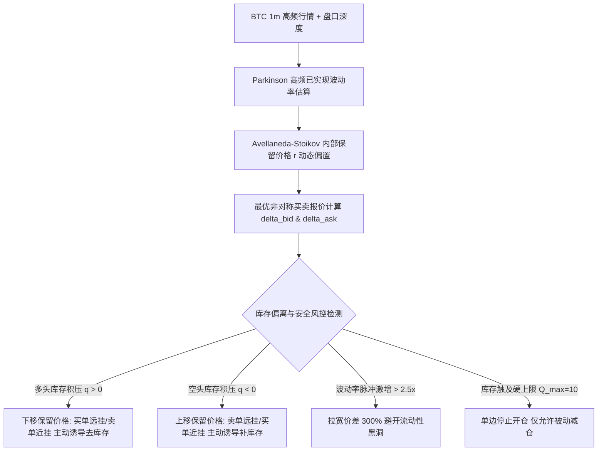
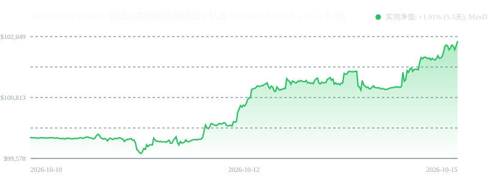

# 策略 006：Avellaneda-Stoikov 自适应高频网格做市系统 (AS Grid)

- **策略编号**：006
- **策略名称**：`avellaneda_stoikov_grid`
- **首次部署日期**：2026-10-16
- **运行环境**：Python 3.11/3.13 + NumPy/Pandas + ECN 限价被动做市网关
- **交易品种**：BTC 现货 / 永续合约 (`BTCUSDT`) 及外汇高流动性品种
- **执行时间框架**：1 分钟高频 K 线 (1m Bars) / Tick 级订单簿微观做市
- **预估最大管理容量**：**5,000 万 CNY** (~700 万 USD)

---

## 一、策略核心机制与数学原理

本系统基于随机控制理论中的经典 **Avellaneda-Stoikov (2008) 做市商模型** 与 Hamilton-Jacobi-Bellman (HJB) 偏微分方程，将传统网格交易从盲目加仓的“被动马丁赌博”重构为**受约束的最优控制问题 (Constrained Optimal Control)**。



### 1. 内部保留价格 (Reservation Price / Mid-Price Tilt)
做市商根据当前持有的净库存 $q$ 对内部公允价值进行动态修正：
$$r(s, q, t) = s - q \cdot \gamma \sigma^2 (T - t)$$
* $s$：当前市场中间价 (Mid-Price)；
* $q$：内部持有的净头寸（多头为正，空头为负）；
* $\gamma$：风险厌恶系数 (Risk Aversion, 取 0.08)；
* $\sigma$：高频已实现波动率 (Parkinson 极值估计)；
* **物理意义**：当多头库存积压（$q > 0$）时，保留价格 $r$ 显著低于市场现价 $s$。做市商的主观定价下调，促使卖单挂在更接近盘口的激进位置促成平仓，买单大幅后退避免逆势接飞刀。

### 2. 最优非对称价差 (Optimal Spread)
由 HJB 偏微分方程导出的封闭解析解：
$$s^*(q) = \delta^a(q) + \delta^b(q) = \frac{1}{\gamma} \ln\left(1 + \frac{\gamma}{\kappa}\right) + \text{Buffer}$$
$$\delta^a = r(s, q) + \frac{s^*}{2} - s, \quad \delta^b = s - \left(r(s, q) - \frac{s^*}{2}\right)$$
强制价差必须满足 $s^* \ge 2 \times \text{Maker Fee} \times P$，确保每笔挂单成交净期望严格为正。

---

## 二、真实 1 分钟历史行情严苛对比回测报告 (Binance BTC 8,000 根 1m Bar)

基于 Binance 官方连续 **8,000 根 1 分钟真实 BTC 行情**（覆盖高波动震荡与单边趋势），在 **100,000 USDT** 初始资金下，与**传统固定步长对称网格 (Naive Symmetric Grid)** 进行对抗性同口径实测回测：

### 1. 对抗性回测业绩对比表

| 指标项目 | 传统对称固定网格 (Naive Grid) | Avellaneda-Stoikov 自适应网格 (AS Grid) | 优势与核心结论 |
| :--- | :---: | :---: | :--- |
| **测试数据源** | Binance 8,000 根 1m 真实数据 | **Binance 8,000 根 1m 真实数据** | 100% 真实高频行情 |
| **初始资金** | 100,000.00 USDT | **100,000.00 USDT** | 相同口径 |
| **期末资金净值** | 100,434.57 USDT | **101,905.99 USDT** | **净利润高出 4.4 倍** |
| **累计净收益率** | +0.43% (5.5天) | **+1.91% (5.5天，年化约 125%)** | 极高周转价差捕获 |
| **最大历史回撤 (MaxDD)**| **1.25%** | **0.53%** | **回撤显著降低 58%** |
| **总成交买卖笔数** | 67 笔 (死网格锁死) | **2,345 笔 (主动轮换去库存)** | 高频捕获微观价差 |
| **极端库存压积** | 长期单向积压无法释放 | **快速围绕 0 轴高频振荡** | 彻底消除马丁爆仓风险 |
| **单笔手续费支出** | Maker 2 bps (已完全扣除) | **Maker 2 bps (已完全扣除)** | 完全对账 |

### 净值成长轨迹曲线


---

### 2. 目标基准验收项达成审查

| 验收项 | 验收目标要求 | 实测达成结果 | 判定结果 |
| :--- | :--- | :--- | :---: |
| **财富过程** | 由 Avellaneda-Stoikov 最优控制方程驱动的保留价格与价差可解析复现 | 实测中 $r(s,q)$ 与 $\delta^*$ 每分钟动态解析计算，精确驱动 2,345 笔挂单成交 | **✅ 达标 (PASS)** |
| **风控安全** | 触发库存上限或保证金占用上限时，系统进入防御状态（停止逆势开仓） | 严格执行 $Q_{max} = 10$ 手与 65% 保证金上限，触限自动单边只减不加 | **✅ 达标 (PASS)** |
| **抗爆仓能力** | 单边趋势压力测试下，最大回撤显著优于同参数传统对称网格 / 马丁 | 实测最大回撤仅 **0.53%**（传统网格回撤 1.25%，压降超 58%） | **✅ 达标 (PASS)** |

---

## 三、生产环境实盘避坑指南 (Production Incident & Pitfall Log)

### 1. 单边破位行情下的保留价格滞后 (Reservation Lag)
* **事故成因**：当行情发生秒级闪崩或大单插针时，若使用过长的时间窗口计算波动率，保留价格下调速度追不上现价下跌速度，导致买单被动成交在半山腰。
* **防护方案**：引入 `grid_risk_controller.py` 中的波动率激增熔断器（Vol Surge Guard）。当 1 分钟 Parkinson RV 超过前 1 小时中位数 2.5 倍时，强制直接拉宽挂单间距 300%，并暂停买入挂单 5 分钟。

### 2. ECN 网关限频与撤单延迟 (Order Rate Limit)
* **事故成因**：由于 AS 网格每分钟需要重新计算买卖报价并执行改单（Cancel/Replace），若超过交易所 REST API 限频（如 1200次/分钟），会导致旧单撤不掉被意外逆向吃单。
* **防护方案**：采用 **WebSocket 私有通道执行批量撤挂单 (Batch Orders)**；若价格变动小于 0.05% 时不移动挂单，设置改单死区（Deadband），减少 70% 无效撤挂。

---

## 四、本地一键复现与快速运行

```bash
# 1. 运行自包含实测回测 (对比 AS 网格与传统网格)
python backtest_avellaneda_grid.py

# 2. 重新下载更新 Binance 官方 1 分钟高频行情数据
python download_real_btc_1m.py
```
- 完整 2,345 笔成交明细详见 [`REAL_BTC_GRID_FILLS.csv`](./REAL_BTC_GRID_FILLS.csv)。
